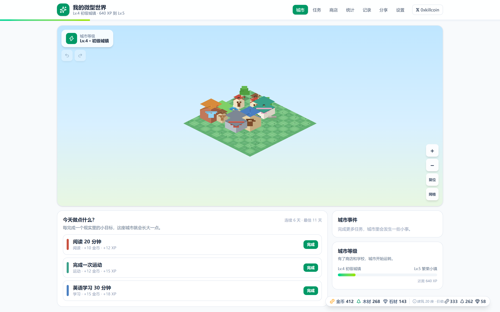
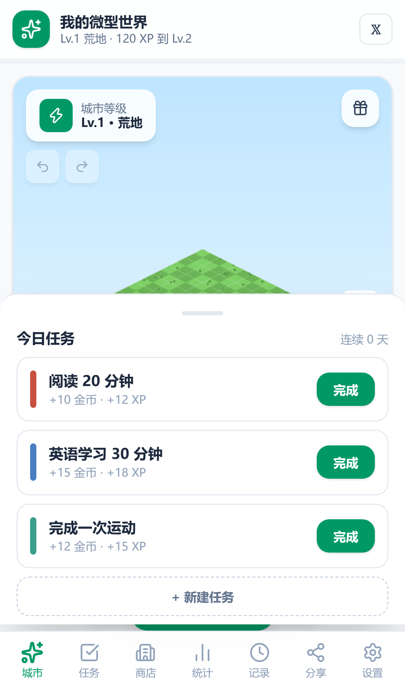
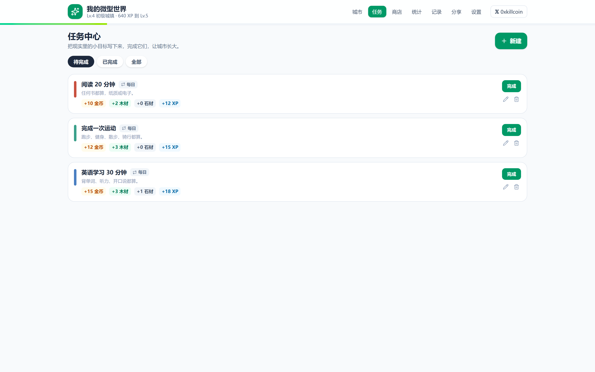
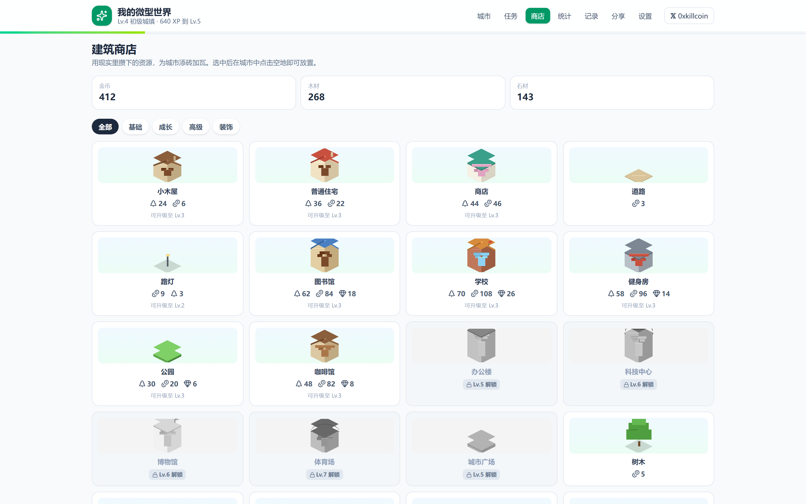
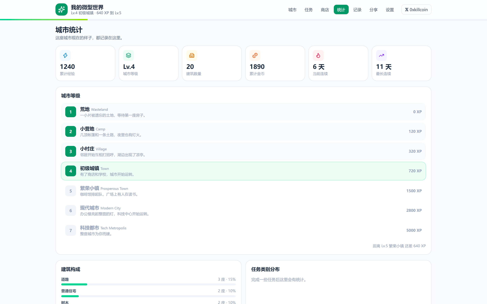
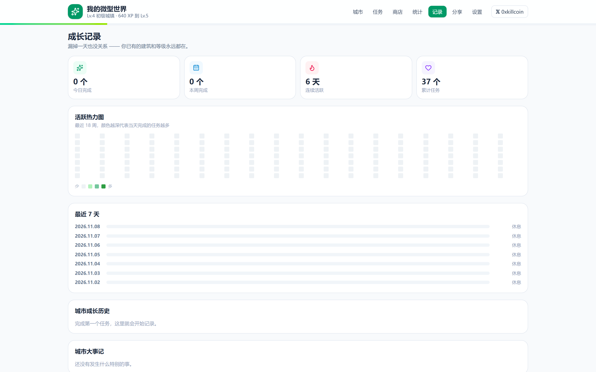
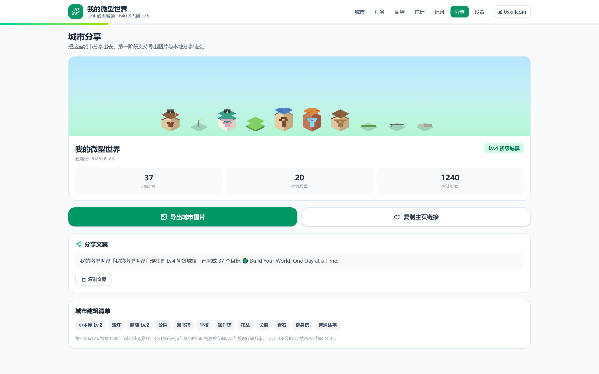
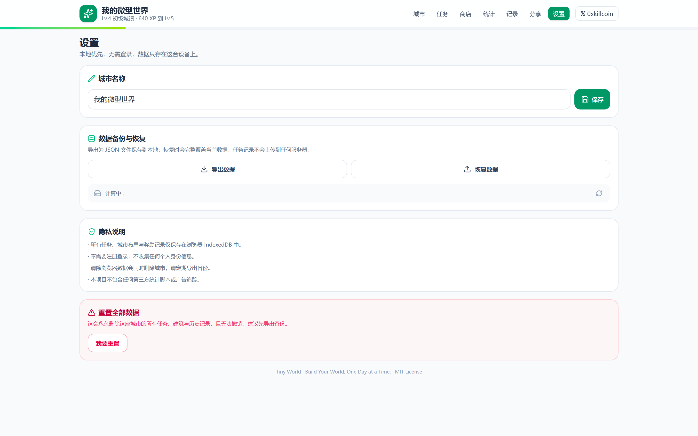

# Tiny World · 我的微型世界

> **Build Your World, One Day at a Time.**
> **每天一点点，建造自己的世界。**

[](https://iiiiiiiiiiiiiKK.github.io/tiny-world/)
[](LICENSE)
[](https://react.dev)
[](https://www.typescriptlang.org)
[](https://vite.dev)
[](https://tailwindcss.com)

**在线演示 →** https://iiiiiiiiiiiiiKK.github.io/tiny-world/

**作者 𝕏 →** https://x.com/0xkillcoin

---

## 📸 效果截图

| 城市主页（桌面） | 城市主页（移动端） |
| :---: | :---: |
|  |  |

| 任务中心 | 建筑商店 |
| :---: | :---: |
|  |  |

| 城市统计 | 成长记录 |
| :---: | :---: |
|  |  |

| 城市分享 | 设置 |
| :---: | :---: |
|  |  |

> 以上截图全部由 `npm run screenshots` 从**真实运行中的应用**自动采集，未使用任何设计稿或占位图。

---

## 🎮 这是什么

**Tiny World（我的微型世界）** 是一个**游戏化个人成长 + 虚拟城市建造**的 Web 产品。

现实生活中的每一个小目标，都会变成虚拟城市里的一块砖、一棵树、一盏灯。

| 你在现实里做的 | 城市里发生的 |
| :--- | :--- |
| 📖 阅读 20 分钟 | 获得金币与木材，解锁一座小木屋 |
| 🏃 完成一次运动 | 城市街道亮起新的路灯 |
| 📝 写一篇文章 | 图书馆窗户里的灯一直亮着 |
| 🌱 坚持一个好习惯 | 公园里的树一天天长高 |

> 这不是又一个签到打卡工具。它不会因为漏掉一天就夺走你的建筑和等级 —— **休息是被允许的**。

---

## ✨ 核心特性

### 🏙️ 可交互的等距像素城市

- **Canvas 2:1 等距投影**渲染，平滑平移与缩放（0.5× – 2.6×）
- **22 种建筑**，全部由统一的程序化像素绘制引擎实时生成（无外部美术资源）
- **网格吸附放置**：绿色可放 / 红色不可放，落点实时反馈
- **碰撞检测**：多格建筑（3×2 科技中心等）按真实占地计算，永不重叠
- **拖动重排**：拖动建筑时实时高亮，无效位置自动回弹
- **撤销 / 重做**：布局操作完整可回滚
- **程序化像素美术**：屋顶、窗户、阴影、地面分层草地全部由代码绘制，风格天然统一

### ✅ 完整的任务系统

- 4 种周期：**每日 / 每周 / 一次性 / 自定义（按星期几）**
- 9 个分类：阅读、学习、运动、工作、写作、习惯、休息、社交、其他
- **奖励幂等发放**：完成记录主键为 `taskId::periodKey`，同一周期重复点击只会发放一次
- 每日 / 每周 / 自定义任务在周期切换时自动重置
- 支持**撤销完成**（会同步回滚经验与资源）

### 💰 统一的经济系统

所有价格、奖励、解锁条件集中在 `src/config/`，**没有任何散落在组件里的魔法数字**。

| 资源 | 用途 |
| :--- | :--- |
| 🪙 金币 Coins | 购买普通建筑与装饰 |
| 🪵 木材 Wood | 建造基础建筑 |
| 🪨 石材 Stone | 升级已有建筑 |

- 起始资源：80 金币 / 100 木材 / 20 石材
- 建筑可升级至 Lv.3，升级成本按 `1.8^(level-1)` 递增
- 拆除返还累计投入的 50%
- **随机事件受每日金币上限（80）约束**，不会打爆经济

### 🏛️ 城市等级系统

| 等级 | 名称 | 需要经验 | 城市范围 |
| :---: | :--- | ---: | :---: |
| 1 | 荒地 | 0 | 6×6 |
| 2 | 小营地 | 120 | 8×8 |
| 3 | 小村庄 | 320 | 10×10 |
| 4 | 初级城镇 | 720 | 12×12 |
| 5 | 繁荣小镇 | 1500 | 14×14 |
| 6 | 现代城市 | 2800 | 15×15 |
| 7 | 科技都市 | 5000 | 16×16 |

升级时城市草地主题色同步变化，并播放专属升级动画。

### 🎲 城市事件

10 种随机事件（新居民搬入、商店开业、城市节日、补给车抵达……），
每完成 4 个任务可能触发一次，带明确权重与前置条件。

### 📊 成长记录

- 18 周**活跃热力图**（GitHub 风格）
- 最近 7 天完成情况
- 连续活跃天数 / 最长连续
- 城市成长历史（累计 XP 时间线）
- 城市大事记

### 📱 移动端优先设计

- 底部标签栏导航（拇指可达）
- **底部任务抽屉**：滑动式今日任务面板，大号完成按钮
- **双指缩放 + 单指拖动**画布
- `env(safe-area-inset-*)` 刘海屏适配
- 全站**零横向溢出**（自动化断言覆盖）

### 🔒 Local-first 隐私

- **无需登录**，打开即用
- 数据保存在浏览器 **IndexedDB**（Dexie.js）
- 任务记录**永不上传服务器**
- 无第三方统计脚本、无广告追踪
- 一键导出 / 恢复 JSON 备份

---

## 🧰 技术架构

```
┌──────────────────────────────────────────────────┐
│  React 19 + TypeScript 7 + Vite 8                 │
│  Tailwind CSS 4 (CSS-first 配置)                  │
├──────────────────────────────────────────────────┤
│  路由      react-router-dom 7 (HashRouter)       │
│  状态      Zustand 5 (单 store + 事务化 action)   │
│  动画      Framer Motion 11                        │
│  图标      Lucide React                            │
├──────────────────────────────────────────────────┤
│  渲染      Canvas 2D 自研等距像素引擎               │
│            src/render/sprite.ts                   │
├──────────────────────────────────────────────────┤
│  持久化    Dexie.js 4 → IndexedDB                  │
│            事务保证「奖励+经验+统计」原子写入         │
└──────────────────────────────────────────────────┘
```

### 目录结构

```
tiny-world/
├── src/
│   ├── config/          # 唯一数值来源：经济 / 建筑 / 事件 / 调色板
│   │   ├── buildings.ts     # 22 种建筑的目录、造价、解锁等级、像素参数
│   │   ├── economy.ts       # 等级曲线、资源定义、分类奖励、随机事件上限
│   │   ├── events.ts        # 城市事件模板与权重
│   │   └── palette.ts       # 全局像素调色板 + 城市等级主题色
│   ├── data/
│   │   ├── db.ts            # Dexie schema
│   │   └── store.test.ts    # 数据层集成测试
│   ├── lib/
│   │   ├── date.ts          # 周期键、时区安全的日期工具
│   │   ├── grid.ts          # 等距投影、碰撞、占地、经济计算
│   │   └── *.test.ts
│   ├── render/
│   │   └── sprite.ts        # 程序化像素建筑渲染引擎
│   ├── store/
│   │   └── useStore.ts      # Zustand store，事务化的核心业务逻辑
│   ├── components/          # CityCanvas / Layout / Toast / UI 原语
│   ├── pages/               # 7 个页面
│   └── types.ts
├── e2e/                     # Playwright 端到端测试
├── docs/screenshots/        # 自动采集的真实截图
└── .github/workflows/       # GitHub Pages 自动部署
```

### 关键技术决策

| 决策 | 理由 |
| :--- | :--- |
| **HashRouter** 而非 BrowserRouter | GitHub Pages 静态托管无服务端 rewrite，hash 路由零配置可用 |
| **Canvas 2D 自研** 而非 PixiJS | 场景建筑数量有限（数百），2D Canvas 已足够；省去 ~100KB 依赖与 WebGL 兼容问题 |
| **程序化像素美术** 而非图片素材 | 许可证干净（MIT 自有代码）、风格统一、可参数化（屋顶/窗户/高度）、构建产物仅 ~196KB gzip |
| **Dexie 事务** 而非裸 IndexedDB | 奖励发放 + 经验更新 + 日统计写入必须原子化，否则会出现重复领奖或数据不同步 |
| **完成记录主键 = `taskId::periodKey`** | 从数据结构层面杜绝同周期重复领奖，比 UI 层加锁更可靠 |

---

## 🚀 本地运行

**环境要求**：Node.js ≥ 20

```bash
# 1. 克隆
git clone https://github.com/iiiiiiiiiiiiiKK/tiny-world.git
cd tiny-world

# 2. 安装依赖
npm install

# 3. 本地开发（热更新）
npm run dev
# → http://localhost:5173

# 4. 生产构建 + 本地预览
npm run build
npm run preview
```

### 环境变量

**不需要任何环境变量。** Tiny World 是纯前端应用，所有数据都在浏览器本地。

如需了解未来可能的配置项，见 [`.env.example`](.env.example)。

---

## 🧪 测试

```bash
npm run test        # 单元 / 集成测试（Vitest，54 项）
npm run test:e2e    # 端到端测试（Playwright，25 项 × 2 视口）
npm run test:all    # 全部
npm run lint        # 静态检查（oxlint）
npm run build       # 类型检查 + 生产构建
```

### 测试覆盖

**单元测试（Vitest，54 项全部通过）**

| 文件 | 覆盖内容 |
| :--- | :--- |
| `src/lib/grid.test.ts` | 占地计算、碰撞检测、放置边界、等距投影**精确互逆**、升级成本缩放、拆除返还 |
| `src/lib/date.test.ts` | 周期键生成、跨月跨年加减天、ISO 周计算、自定义星期匹配 |
| `src/config/economy.test.ts` | 建筑目录完整性（唯一 ID / 必需清单 / 造价非零）、等级曲线单调性、事件权重与经济上限 |
| `src/data/store.test.ts` | 任务创建 / 完成 / **重复领取拦截** / 删除级联 / 资源不足拦截 / 建造 / 升级 / 移动 / 碰撞 / 撤销重做 / 导出导入往返 |

**端到端测试（Playwright，桌面 1440×900 + iPhone 13 两套视口）**

- 首页加载、Canvas 可见、资源条正确
- 完成任务发放奖励并变为「已完成」
- 创建新任务并出现在列表
- 未解锁建筑显示锁标记且拒绝建造
- **建造后资源被正确扣除**（木材 100 → 76）
- 建造建筑 → 选中 → 升级到 Lv.2
- **碰撞检测**：同一位置二次放置被拒绝
- 刷新页面后任务数据仍在（IndexedDB 持久化）
- 导出 JSON 备份结构有效
- 统计页 / 成长记录页渲染
- 分享页导出城市 PNG
- 顶部 𝕏 作者链接指向 x.com/0xkillcoin
- 移动端底部导航可见 + **无横向溢出**

---

## 🚢 部署

### GitHub Pages（推荐，已配置）

仓库内置 `.github/workflows/deploy.yml`，推送到 `main` 即自动构建并部署。

1. 打开仓库 **Settings → Pages**
2. **Source** 选择 `GitHub Actions`
3. 等待 Actions 跑完，访问 https://iiiiiiiiiiiiiKK.github.io/tiny-world/

### Cloudflare Pages / Vercel

均为纯静态站点，直接导入仓库即可：

| 平台 | Build 命令 | 输出目录 |
| :--- | :--- | :--- |
| Cloudflare Pages | `npm run build` | `dist` |
| Vercel | `npm run build` | `dist` |

> Vite 已配置 `base: './'`，产物使用相对路径，可部署在任意子路径下。

### 手动部署

```bash
npm run build
# 将 dist/ 目录上传到任意静态托管服务
```

---

## 🔐 安全与隐私

- ✅ 所有数据存于浏览器本地 IndexedDB，**不发送到任何服务器**
- ✅ 无账号体系、无 Cookie 追踪、无第三方分析脚本
- ✅ 无 `dangerouslySetInnerHTML`，无动态代码执行
- ✅ 导入数据时校验 `format` 字段，格式不符直接拒绝
- ✅ 导入在单个 Dexie 事务中完成，失败时整体回滚
- ✅ 仓库内**不含任何密钥或令牌**
- ✅ 依赖许可证全部兼容 MIT（见下方）

---

## 📦 依赖许可证

| 依赖 | 许可证 |
| :--- | :--- |
| react / react-dom | MIT |
| react-router-dom | MIT |
| zustand | MIT |
| dexie / dexie-react-hooks | Apache-2.0 |
| framer-motion | MIT |
| lucide-react | ISC |
| vite / @vitejs/plugin-react | MIT |
| tailwindcss / @tailwindcss/vite | MIT |
| typescript | Apache-2.0 |
| vitest | MIT |
| @playwright/test / playwright | Apache-2.0 |
| fake-indexeddb | Apache-2.0 |
| tsx / oxlint | MIT |

**本项目所有美术资源均为程序化生成，版权归项目所有，MIT 授权。**

---

## 🧭 已知限制

- 城市分享当前支持**导出图片**与**复制本地链接**；真正的公开城市主页需要独立后端与多用户数据存储，本项目不将本地数据伪装为已公开。
- 不支持多设备同步（跨设备需要后端账号体系）。
- 建筑**旋转**未实现（当前像素素材为等距固定朝向）。
- 清除浏览器站点数据会同时删除城市，请定期使用设置页导出备份。
- 匿名模式下浏览器可能禁用 IndexedDB，应用会给出明确提示。

## 🗺️ 后续计划

- [ ] 可选的云端同步（Cloudflare Workers + D1 / R2）
- [ ] 公开城市分享页（只读 + 快照）
- [ ] 建筑旋转与更多朝向变体
- [ ] 城市装饰自由摆放与主题配色
- [ ] 更多像素地形：河流、海岸、季节变化
- [ ] 任务模板库与自定义奖励曲线

---

## 🤝 贡献指南

欢迎提交 Issue 和 Pull Request。

1. Fork 本仓库
2. 创建特性分支：`git checkout -b feature/your-feature`
3. 安装依赖并确保全部检查通过：
   ```bash
   npm install
   npm run lint && npm run test && npm run build
   ```
4. 提交 PR，描述你的改动与动机

**代码风格**：TypeScript strict、2 空格缩进、单引号、分号结尾。
**提交前请务必跑通 `npm run test:all`。**

---

## 📄 许可证

[MIT](LICENSE) © Tiny World Contributors

---

<div align="center">

**Tiny World · 我的微型世界**

每天一点点，建造自己的世界。

Made with ❤️ by [@0xkillcoin](https://x.com/0xkillcoin)

</div>
